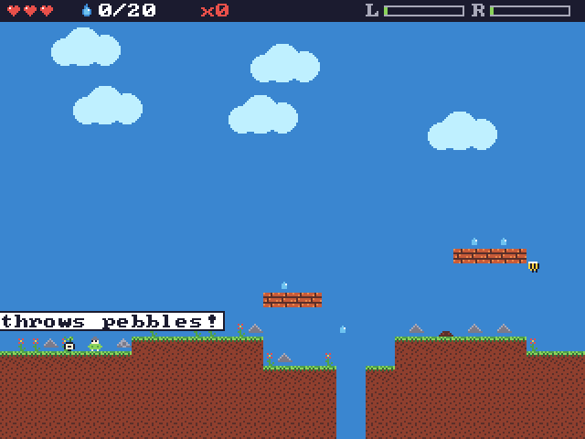

<div align="center">


# PocketBit

**A DIY handheld game console you can build, hack and make games for.**

ESP32-S3 · 3.2" IPS · analog triggers · stereo sound · wireless multiplayer


[](https://github.com/Dvrkstvr/bitkit)
[](https://dvrkstvr.github.io/bitkit/)

### [▶ Make games for it now](https://dvrkstvr.github.io/bitkit/) · [BitKit software](https://github.com/Dvrkstvr/bitkit)



<sub>The same runtime you see here in the browser will run on the device.</sub>

</div>

---

## 🎯 What it is

PocketBit is the hardware half of the project: the PCB, the shell and the bill of materials.
The firmware, game runtime and browser studio live in **[BitKit](https://github.com/Dvrkstvr/bitkit)**.
You can already make and play games in the browser with a gamepad. When the board exists, the same carts will run on it.

## 🔧 Planned hardware

| Part | Choice |
|---|---|
| MCU | ESP32-S3 (dual core, PSRAM) |
| Screen | 3.2" 320×240 IPS, ST7789V2, 8-bit parallel |
| Controls | D-pad, A/B/X/Y, Start/Select, L/R shoulders |
| Analog | Hall-effect L/R triggers through an external ADC, so ADC2 stays free for Wi-Fi/ESP-NOW. Analog face buttons are an experiment |
| Audio | Stereo speakers |
| Clock | RTC for idle/farming games that keep growing while it's off |
| Wireless | ESP-NOW for local multiplayer, visits and trades |
| Power | Li-ion with instant wake and pause/resume |

## 🎮 Software highlights

- 60 fps locked target, with Lua games on a C runtime.
- A launcher home screen with utility apps (Home Assistant and more).
- Emulation of classic 8-bit systems as a stretch goal.
- Later experiments: 2.5D and low-poly 3D.

## 🗺️ Roadmap

- [x] Runtime and browser studio ([BitKit](https://github.com/Dvrkstvr/bitkit))
- [ ] Breadboard prototype: ESP32-S3 + display + buttons
- [ ] BitKit ESP32 host running carts on the prototype
- [ ] Analog trigger and audio tests
- [ ] Schematic and PCB v1
- [ ] 3D-printable shell
- [ ] BOM and build guide

## 📁 Layout (as it fills in)

```
pcb/        KiCad schematic and board
shell/      3D-printable enclosure
bom/        Bill of materials
docs/       Build guide, photos and notes
```

## 🤝 Contributing

Ideas and hardware advice are very welcome. Open an issue, or try the [studio](https://dvrkstvr.github.io/bitkit/) and make something.

## 📄 Licence

Hardware designs will be released under **CERN-OHL-P v2** (permissive open hardware). BitKit software is MIT.

<div align="center"><sub>Made for tinkerers who want to hold their games in their hands.</sub></div>
